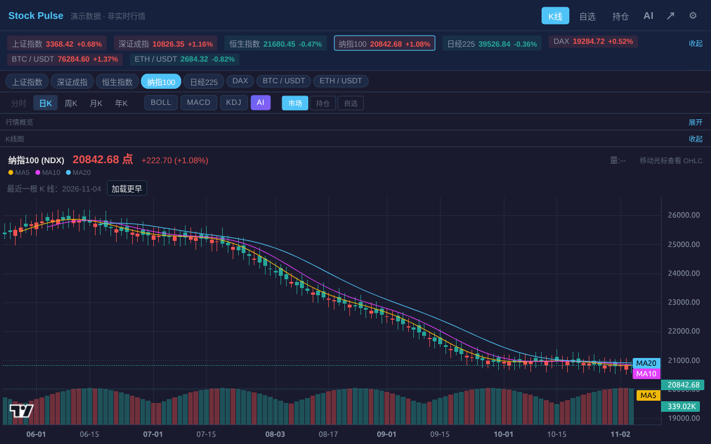
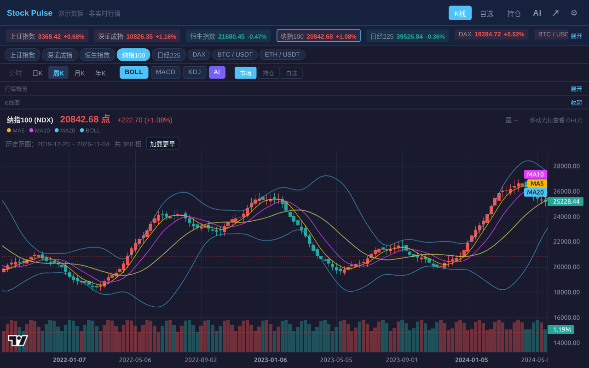
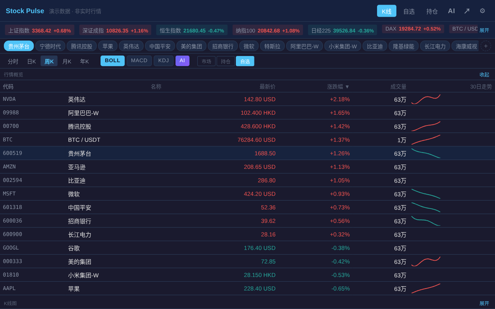
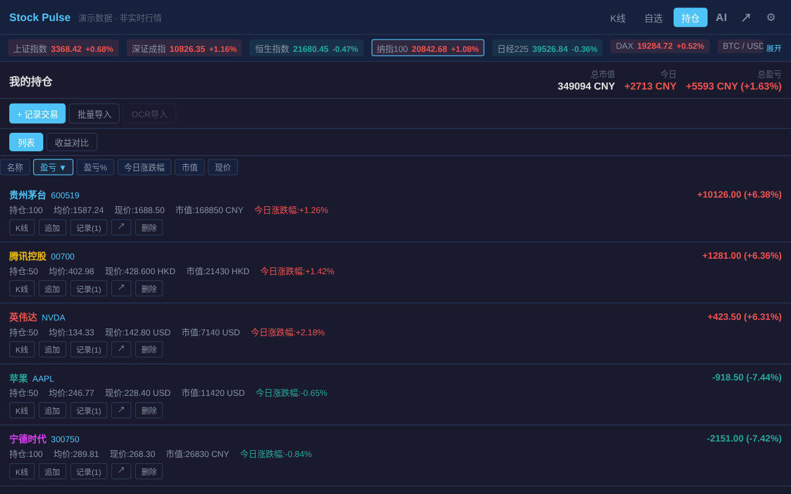
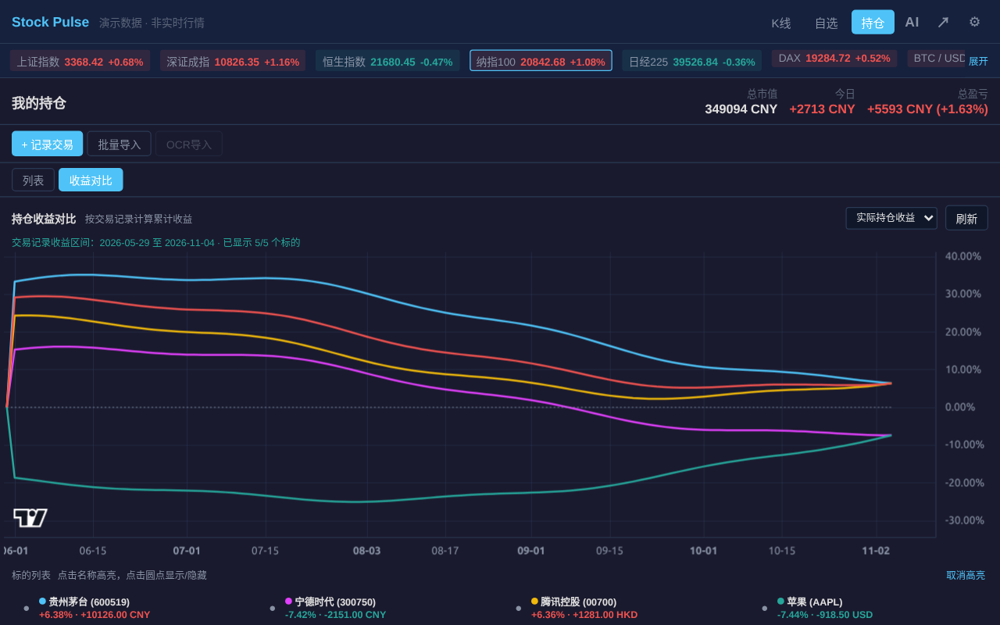
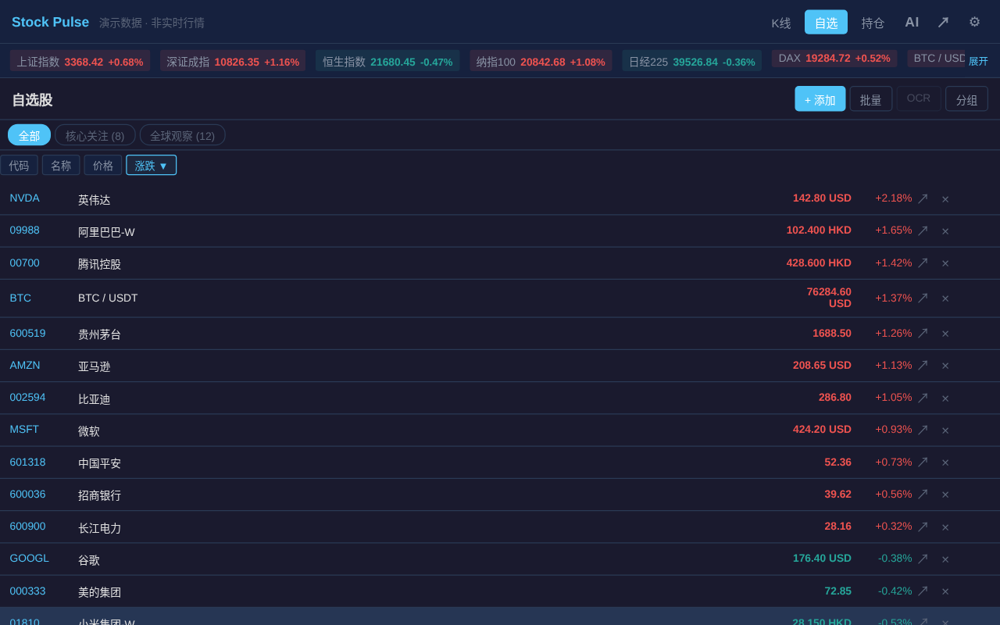
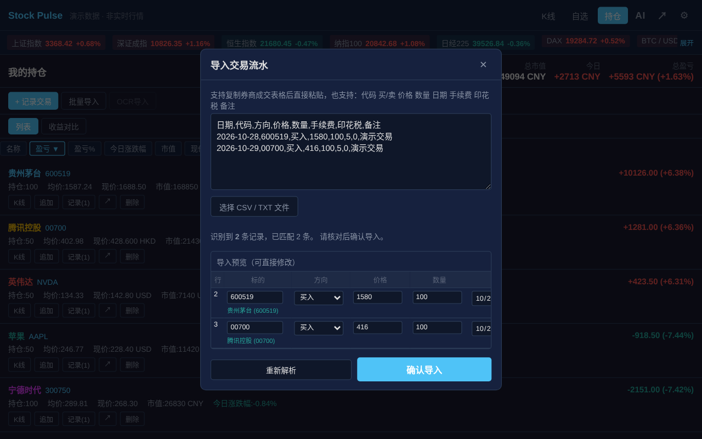
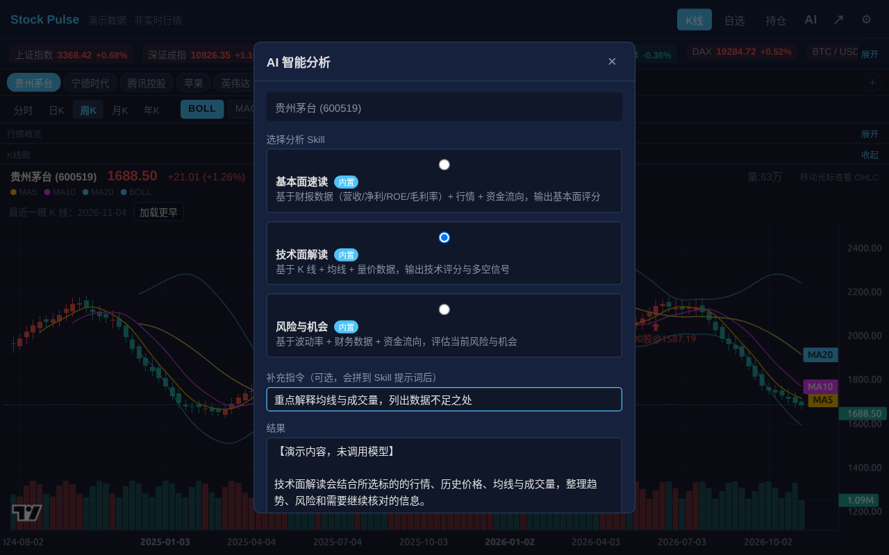

# Stock Pulse — K 线行情与持仓助手

**把市场信息，放在手边。**

Stock Pulse 是一款浏览器侧边栏行情与持仓工具，支持 A 股、港股、美股、全球指数及 BTC/ETH。无需离开当前网页，即可查看走势、管理自选股、记录交易、比较实际收益，并连接自选 AI 模型辅助研究。

## 主要功能

| 模块 | 功能 |
| --- | --- |
| 行情与技术指标 | 个股分时、日 K、周 K、月 K、年 K；MA5/10/20、BOLL、MACD、KDJ、成交量及买卖点标记；分时均价线与昨收参考线 |
| 历史走势 | 拖动或点击按钮加载更早数据，保持当前日期位置与缩放；周、月、年周期带年份；历史范围取决于数据源 |
| 全球市场 | 自定义顶部指数与币种，点击进入“市场”分组查看主图；支持日、周、月、年周期，市场分组暂不提供分时 |
| 多标的概览 | 最新价、涨跌幅、成交量与 30 日迷你走势；独立滚动与排序；市场区可收起为一行，图表可单独收起，让列表展示更多标的 |
| 自选股 | 搜索名称与代码、部分 Web3 合约地址查询、分组管理、批量文本添加、截图 OCR 辅助识别及右键快捷加入 |
| 持仓与交易 | 买入、卖出、成交时间、手续费、印花税；自动计算均价、市值、当日盈亏与累计盈亏；每只持仓展示今日涨跌幅并支持排序 |
| 收益对比 | 根据实际买卖记录与费用计算持仓收益，也可切换为标的价格表现；多标的显示、隐藏与高亮 |
| 批量导入 | CSV、TSV、券商复制文本及截图 OCR；导入前预览、修改、校验和去重；整批校验后写入，避免部分导入 |
| AI 分析 | 基本面速读、技术面解读、风险与机会三个内置 Skill；支持补充关注点、自定义 Skill 及导入导出 |
| 个性化与备份 | 暗色/亮色、自定义强调色、交易所/本地/自定义时区、CNY/HKD/USD 汇总、本地数据备份与恢复 |

### 多市场与多数据源

实时报价与图表数据源可独立选择，海外股票可单独配置。支持腾讯、东方财富、新浪、Tushare、聚合数据及加密资产数据源。

指数显示点位，海外股票显示对应货币单位。BTC/ETH 的涨跌幅采用近 24 小时口径；股票持仓展示当日涨跌幅。数据缺失或请求失败时提供明确提示，已有图表缓存可继续查看。

### AI Skills 与 OCR

AI 分析使用用户配置的模型服务，支持 OpenAI 兼容接口，以及 DeepSeek、通义千问、月之暗面、OpenRouter、Gemini 等预设。内置 Skill 结合可用的行情、历史走势、财务、公告与资金流信息整理分析，也支持用户自定义内容。

OCR 需要支持图片输入的视觉模型，可辅助识别自选代码和交易文本，识别结果可在写入前核对、修改。AI 与 OCR 的可用性和费用取决于用户选择的服务商。

## 界面展示

以下为 v1.4.0 实际扩展界面，使用虚构演示行情、持仓和交易数据；AI 页面中的内容为已标注的示例。

### 全球行情

| 更早历史与跨年查看 | 收起图表，展示更多标的 |
| --- | --- |
|  |  |

| 今日涨跌与持仓盈亏 | 实际持仓收益对比 |
| --- | --- |
|  |  |

| 分组自选股 | 交易流水导入预览 |
| --- | --- |
|  |  |

### AI 辅助研究

## 数据与隐私

- 自选股、持仓、交易记录、设置和 Skill 保存在浏览器本地。
- 查询行情时，向数据源发送标的代码等必要请求信息。
- 主动运行 AI 或 OCR 时，相关分析上下文或截图会发送给用户配置的模型服务商。
- API Key 和 Token 仅在调用对应服务时发送给所选服务商；数据备份默认不包含这些凭证。
- 插件不设置作者自有的数据收集服务器，不出售用户数据。详细说明见 [隐私政策](privacy.html)。

本项目用于信息查看与个人研究，不构成投资建议或收益承诺。免费行情接口可能受到网络、频率限制和服务可用性影响，AI/OCR 结果需要自行核对。
